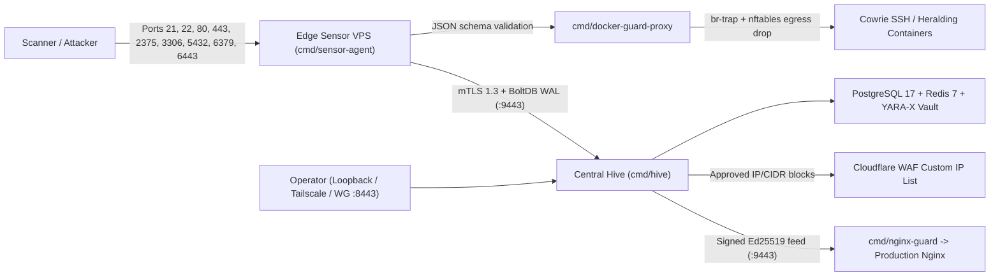

# Distributed Cyber Deception & Active Defense Honeypot Platform

> Full-stack Go + PostgreSQL 17 + Redis 7 + React cyber deception orchestrator combining traditional service traps (`Cowrie` SSH/Telnet, `Heralding` FTP/SMTP/POP3/IMAP), deterministic modern web/cloud CVE emulation, a protocol-authentic **Chameleon LLM Deception Gateway**, SSRF-hardened YARA-X malware capture, and human-governed **Cloudflare WAF + Production Nginx** active defense.

[](go.mod)
[](LICENSE)

---

## Why This Project Exists

Traditional honeypots focus either on legacy SSH/Telnet shells or on static HTTP loggers, leaving operators blind to modern exploit chains: React Server Components deserialization (`React2Shell`), Next.js middleware bypasses, leaked AI inference endpoints/API keys, Docker/Kubernetes daemon probes, and multi-IP attacker workflows (recon from `IP_1`, LLM or payload staging from `IP_2`).

This platform unifies isolated edge sensors with a private **Central Hive**:

- **Never put production credentials on exposed edge sensors.** Canary API keys are HMAC-derived and tracked per placement; only authorized Hive components hold real upstream keys, threat-intel tokens, Cloudflare tokens, and database access.
- **No blind auto-banning.** Benign research scanners (`GreyNoise == benign`) are suppressed before triage, RFC1918/IMDS/Cloudflare ranges are permanently locked via PostgreSQL GIST guardrails, and high-confidence attacks default to human approval before syncing edge WAF/Nginx blocks.
- **Zero public exposure for the Control Plane.** The Admin Console (`:8443`) refuses `0.0.0.0`, `::`, and generic WAN NICs at startup unless overridden explicitly for local dev (`--unsafe-dev-bind`), serving only over loopback (`ssh -L`), Tailscale, or WireGuard with Argon2id + TOTP 2FA.



---

## Key Capabilities & Deception Surfaces

| Surface | Components & Protocol Coverage | Source Owner |
|---|---|---|
| **Legacy Service Traps** | `Cowrie` (SSH `:22` & Telnet `:23` + custom `fs.pickle` honeyfs + canary breadcrumbs + asciinema TTY replay) & `dtagdevsec/heralding` (FTP `:21`, SMTP `:25`, POP3 `:110`, IMAP `:143`), spawned strictly via `docker-guard-proxy` (`CapDrop=ALL`, `ReadonlyRootfs`, `PidsLimit`, `br-trap` isolation) | [`internal/orchestrator`](internal/orchestrator), [`cmd/docker-guard-proxy`](cmd/docker-guard-proxy), [`internal/traps/cowrieparser`](internal/traps/cowrieparser), [`internal/traps/heraldingparser`](internal/traps/heraldingparser) |
| **Dual-Mode TLS & Fingerprinting** | Simultaneous Let's Encrypt ACME domain certificates + dynamic per-IP self-signed ECDSA TLS without dropping raw-IP scanners; `JA4` TLS ClientHello + `JA4H` HTTP fingerprinting | [`internal/netwrap`](internal/netwrap) |
| **13 Web KEV Packs + Real `.git` Lure** | Deterministic YAML packs (`Next.js CVE-2025-29927 & SSRF`, `React2Shell CVE-2025-55182` UTF-16LE, `Vite`, `Node2Shell`, `PHP-CGI %AD`, `php2shell`, `Laravel`, `PHPUnit`, `Apache 2.4.49`, `WordPress`, `Spring4Shell`, `Log4Shell`) + bare `go-git/v5` `/.git` repo serving canary secrets | [`internal/traps/webcve/packs`](internal/traps/webcve/packs), [`internal/traps/webcve`](internal/traps/webcve) |
| **Cloud & Database Infra Traps** | Unauth Docker Remote API (`:2375`), Kubernetes API (`:6443`) & Dual HTTP/HTTPS Kubelet (`:10250`), Redis RESP (`:6379`), MySQL (`:3306`), PostgreSQL (`:5432`) credential & RCE traps | [`internal/traps/infratrap`](internal/traps/infratrap) |
| **Chameleon LLM Gateway + AI KEVs** | Protocol-authentic OpenAI (`/v1/*`), Anthropic (`/v1/messages`), Ollama (`/api/*`, also bindable on `:11434`), and LiteLLM (`/key/generate`, also bindable on `:4000`) proxy. Strips `system`/`developer` overrides, scrubs upstream vendor leaks mid-SSE via `StreamSanitizer`, enforces Redis Lua `MAX_DAILY_USD`, and falls back to `$0` Slow SSE Tarpit; includes `anything-llm`, `BentoML`, `ShadowRay`, `vLLM`, `Langflow`, `OpenWebUI`, `Ollama`, `LiteLLM` CVE emulators | [`internal/traps/llmproxy`](internal/traps/llmproxy), [`internal/traps/llmproxy/aicves`](internal/traps/llmproxy/aicves) |
| **Malware Quarantine & Enrichment** | Sensor-side SSRF-hardened `SafeDownloader` (blocks RFC1918/IMDS/loopback/IPv6 transition/CDN allowlist & DNS rebinding), Hive immutable disk vault (`chmod 0400`), YARA Dual-Scanner (`!yarax` Pure-Go / `-tags yarax` Rust `libyara_x_capi`), MaxMind MMDB + GreyNoise + AbuseIPDB + VirusTotal | [`internal/malware`](internal/malware), [`internal/enrichment`](internal/enrichment) |
| **Correlation, Policy & Active Guard** | Multi-IP Kill-Chain Correlator (links recon `IP_1` to canary reuse `IP_2`), Zero-Blind-Auto-Ban Policy Engine, PostgreSQL GIST allowlist (`cidr && $1::inet`) with `/24`/`/48` floors, Cloudflare WAF sync, Ed25519 anti-rollback `nginx-guard` with immediate Emergency Unban reload | [`internal/correlation`](internal/correlation), [`internal/policy`](internal/policy), [`internal/guard`](internal/guard), [`cmd/nginx-guard`](cmd/nginx-guard) |
| **Private Admin Console (7 Screens)** | Embedded React 19 + Tailwind SPA (`Overview`, `Incidents Explorer`, `LLM Spy`, `Nodes & Containers`, `Canary Factory`, `Malware Vault` AE-2 ZIP export, `Active Guard`), live WebSocket stream, Argon2id + TOTP 2FA, Telegram/Discord/Webhook alerts | [`internal/adminapi`](internal/adminapi), [`web/src/pages`](web/src/pages), [`internal/notify`](internal/notify) |

---

## Architecture & Security Invariants

Deep design rationale, trust boundaries, protocol sequences, and package ownership live in **[ARCHITECTURE.md](ARCHITECTURE.md)**. Contributor playbooks live in **[DEVELOPMENT.md](DEVELOPMENT.md)**.

Four core invariants govern the entire stack:

1. **Zero Blind Auto-Ban ([`migrations/00002_telemetry_incidents.sql`](migrations/00002_telemetry_incidents.sql), [`internal/policy/engine.go`](internal/policy/engine.go)):** Known benign scanners (`GreyNoise == benign`) hit Priority 1 `ignore` and auto-dismiss stale items; KEV, Canary, Malware, and multi-trap hits stage into `pending_approval` triage until approved by an operator (unless explicitly overridden in Policy Rules).
2. **Protected Allowlist Guardrails ([`migrations/00001_core_nodes.sql`](migrations/00001_core_nodes.sql), [`internal/store/postgres.go`](internal/store/postgres.go)):** System-locked RFC1918, loopback, CGNAT, Cloud IMDS, and Cloudflare IPv4/IPv6 ranges cannot be deleted; new guard blocks reject overlaps (`GIST &&`) and broad prefixes above `/24` IPv4 or `/48` IPv6.
3. **Strict Control-Plane Isolation ([`internal/adminapi/server.go`](internal/adminapi/server.go)):** `:8443` Admin HTTP/WebSocket API only accepts `127.0.0.1`, `::1`, or a verified VPN interface (`tailscale0`, `wg0` via `HIVE_ADMIN_IFACE`); `:9443` mTLS ingress isolates enrollment bootstrap (`enroll.*` SNI) from authenticated node traffic (`RequireAnyClientCert` + empty `ClientCAs` + SPIFFE role separation).
4. **Bounded LLM Spend & DoS Protection ([`internal/traps/llmproxy/budget`](internal/traps/llmproxy/budget)):** Only `paid_upstream_eligible` seeded Canary Keys may consume the atomic Redis Lua daily USD budget; unauthenticated calls and `/key/generate` pool keys cost `$0`.

---

## Quickstart

### Prerequisites

- **Build from source:** Go `1.26+`, Node.js `22+`, `pnpm` (`10+`), Docker Engine + Compose v2.
- **Hive Runtime:** PostgreSQL 17, Redis 7 (`deployments/hive/docker-compose.hive.yml` provisions both on loopback ports `15432` and `16379`).
- **Sensor Runtime:** Dedicated Linux VPS with `systemd`, Docker Engine, `nftables`, and a non-standard port for administrative OpenSSH if forwarding port `22` to Cowrie.

### 1. Local Build & Verification

```bash
# Build embedded React SPA + static CGO_ENABLED=0 binaries into ./bin/
make build

# Run full Go integration & race suite (requires Postgres 17 + Redis 7 running)
RUN_INTEGRATION_TESTS=1 go test -race -count=1 ./...

# Verify CGO_ENABLED=0 edge/agent packages + web unit tests
make test && pnpm --dir web lint && pnpm --dir web test
```

See [`DEVELOPMENT.md`](DEVELOPMENT.md) for containerized test database setup commands.

### 2. Deploy Central Hive (Docker Compose with Native `libyara_x_capi`)

On your isolated Hive host (or All-in-One VPS):

```bash
cp .env.example deployments/hive/.env
chmod 600 deployments/hive/.env
# Edit deployments/hive/.env: set strong POSTGRES_PASSWORD, HIVE_CANARY_MASTER_KEY (openssl rand -hex 32),
# HIVE_INGRESS_SANS (add your Hive public IP/domain), and HIVE_PUBLIC_INGRESS.

docker compose --env-file deployments/hive/.env -f deployments/hive/docker-compose.hive.yml up -d --build
```

Create your first **Admin TOTP user** strictly over SSH local port forwarding (or Tailscale/WireGuard):

```bash
ssh -L 8443:127.0.0.1:8443 <user>@<hive-host>
# Open http://127.0.0.1:8443 in your browser to initialize operator credentials + TOTP QR code.
```

Generate a one-time enrollment token for a Sensor VPS (never echoed to shell history when captured securely):

```bash
docker compose --env-file deployments/hive/.env -f deployments/hive/docker-compose.hive.yml \
  exec -T hive /usr/local/bin/hive --create-join-token sensor:sensor-vps-1
```

### 3. Bootstrap an Edge Sensor VPS

Before exposing port `22` to Cowrie on a dedicated Sensor (or All-in-One) VPS, move real OpenSSH `sshd` to an administrative port (e.g., `22222`), verify key login on the new port first, and then run [`scripts/install-sensor.sh`](scripts/install-sensor.sh) + [`scripts/lockdown-nftables.sh`](scripts/lockdown-nftables.sh):

```bash
sudo \
  HIVE_ADDR="<hive-host>:9443" \
  ENROLL_TOKEN="<hpj_token>" \
  CA_FINGERPRINT="<64-hex-sha256>" \
  PUBLIC_IPV4="<sensor-public-ip>" \
  AI_GATEWAY_URL="http://<sensor-public-ip>" \
  ./scripts/install-sensor.sh
```

This reserves UID `1000` (`honeypot`), applies dual-stack `nftables inet` egress lockdown on `br-trap` + cloud IMDS, enrolls over `:9443` `enroll.*` SNI with Root CA pinning (no VPN needed on sensors), and starts `honeypot-docker-guard.service` + `honeypot-sensor.service`.

### 4. Attach Production Nginx (`nginx-guard`)

Mint a `nginx_guard` join token (`--create-join-token nginx_guard:prod-web-1`), enroll [`cmd/nginx-guard`](cmd/nginx-guard) using [`deployments/nginx-guard/nginx-guard.service`](deployments/nginx-guard/nginx-guard.service), and include [`honeypot_geo_blocklist.conf`](deployments/nginx-guard/honeypot_geo_blocklist.conf.bootstrap) + [`honeypot_block_snippet.conf`](deployments/nginx-guard/honeypot_block_snippet.conf) in your production `nginx.conf`.

---

## Documentation Index

- **[ARCHITECTURE.md](ARCHITECTURE.md)** — Trust boundaries, full attack-to-enforcement sequence diagram, module ownership map, and architectural decisions/trade-offs.
- **[DEVELOPMENT.md](DEVELOPMENT.md)** — Local dev setup, Protobuf/Vite/Go workflows, testing matrix, and playbooks for adding Web CVEs, AI KEVs, Infra traps, and Admin UI views.
- **[.env.example](.env.example)** — Complete reference of environment configuration variables.
- **[LICENSE](LICENSE)** — MIT License.
